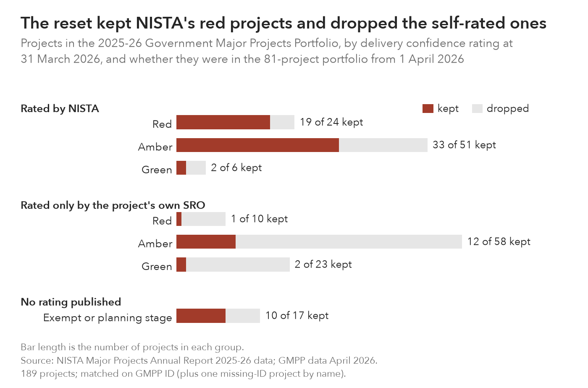

# What happened to Whitehall's other 110 projects?

*The government has substantially reduced the number of major projects it oversees centrally. I wanted to find out which ones were dropped, and what we stand to lose by no longer hearing about them.*

---

On 26 March 2026, the board of a government IT programme called Matrix met to reconsider its timetable.

Matrix is an £890 million undertaking to move nine government departments onto a shared system for finance, human resources, payroll and pensions. It is the sort of government IT project that attracts very little public interest until something goes wrong. Tens of thousands of civil servants depend on systems like these to be paid correctly, have their pension contributions recorded and have their personal information handled securely.

Things were not going particularly well.

The first departments were supposed to switch over in May, with the entire programme due to finish in November 2026. But even before full testing could begin, the department had discovered what it rather delicately described as “some data segments having been unintentionally visible”. The pension provider could not say when its connection to the system would be ready. Departments were struggling to release enough staff to test the software. The Treasury had attached six conditions to the following year's funding.

The completion date was pushed back by a year, and the person responsible for delivering the programme rated it red.

Five days later, the government [announced](https://www.gov.uk/government/news/government-refocuses-major-projects-to-boost-delivery-of-national-priorities) that it was reducing the size of its Government Major Projects Portfolio (GMPP) from over 200 projects to around 80.

Matrix was absent from the [new list](https://www.gov.uk/government/publications/government-major-projects-portfolio).

I came across this sequence of events while looking through the government's annual major projects data. What caught my attention was that, had the timing been slightly different, the details of that March meeting might never have been routinely published.

Matrix was still on the portfolio at the end of the 2025–26 reporting year, so the Department for Science, Innovation and Technology had to provide a public update in July. Next year, it will no longer have that obligation under the existing portfolio reporting arrangements.

That made me wonder what else had dropped off the list.

## Has the government been tidying up the scoreboard?

The Government Major Projects Portfolio brings together some of the largest, most expensive and most difficult things the British government is trying to do. It includes everything from building prisons and nuclear power stations to replacing ageing tax systems and procuring warships.

The projects receive varying degrees of oversight and support from the National Infrastructure and Service Transformation Authority (NISTA), which took over the functions of the old Infrastructure and Projects Authority.

For those of us outside government, however, one of the portfolio's most useful features is its annual publication.

Since 2013, it has given the public a reasonably consistent way of finding out what these projects are expected to cost, when they are supposed to finish and how confident the government is that they will succeed. It is particularly valuable because much of the more detailed material produced during government project reviews is not routinely published.

A project turning red does not necessarily mean it will fail. But it gives journalists, parliamentarians and others a useful indication of where to start asking questions, preferably before the money has been spent.

The new arrangements prioritise projects that support major government objectives, have whole-life costs exceeding £1 billion and would benefit most from central support and scrutiny. Responsibility for assuring the remaining projects passes back to departments.

Given what happened to Matrix, there was an obvious question worth asking. Had the government removed some of its worst-performing projects, making the remaining portfolio appear healthier in the process?

In July, NISTA [published the data](https://www.gov.uk/government/publications/nista-major-projects-annual-report-2025-26) for the 189 projects that were on the portfolio at the end of March. I matched those projects against the new list to see which had stayed and which had gone.

The results were rather different from what the Matrix example might lead one to expect.

Of the 34 projects rated red, 20 remained on the portfolio. Of the 109 rated amber, 45 remained. And of the 29 rated green, only four remained.

If the intention was to make the government's major projects look healthier, the resulting selection has done a poor job of it. The new portfolio contains a considerably higher proportion of troubled projects than the old one.

There was, however, something more interesting going on in the data.

## It matters who gave the project its rating

One of the peculiarities of the annual major projects report is that the ratings do not all come from the same place.

Each project has a senior responsible owner (SRO) who submits a quarterly assessment of its progress. Where NISTA has provided active support or independent assurance within the previous six months, the published report uses NISTA's own assessment instead.

Of the 189 projects in the July report, 81 had a NISTA rating. Another 91 had only the assessment provided by the person responsible for the project. The remaining 17 had no published rating.

This distinction turns out to be particularly important in understanding which projects survived the cuts.

Around two-thirds of the projects rated by NISTA remained on the portfolio. Only one in six of those rated solely by their own senior responsible owners did.

The difference is especially striking among the red-rated projects. NISTA had rated 24 projects red, and 19 of them stayed. Departments had rated another ten of their own projects red, and just one of those stayed.

Projects that had received a recent independent assessment were much more likely to remain on the portfolio, even when they shared the same delivery confidence rating as projects that were removed.

Some of this difference can be explained by the size of the projects. NISTA tends to assess the more expensive ones, and the new £1 billion threshold excludes much of the old portfolio. Of the 59 projects with a published whole-life cost of £1 billion or less, 51 were removed.

But the financial threshold does not explain everything. More than half of the 74 projects with published costs above £1 billion were removed as well.

The figures suggest that the old portfolio already contained two quite different groups of projects. There were those receiving recent central assurance or support, and those whose departments were submitting their own assessments without active NISTA monitoring.

The distinction was largely obscured by presenting them together in the same annual report.

Seen in this light, reducing the portfolio to around 80 projects seems a more understandable decision. The government is concentrating its central assurance resources on a smaller group, and the published portfolio is moving closer in size to the group that was receiving recent central attention anyway.

What interests me is what happens to the projects on the other side of that decision.

For the 76 departing projects that had only a departmental rating, the most immediate loss is the obligation to report publicly each year. They were already receiving relatively little direct attention from NISTA.

For the 27 departing projects that had received a NISTA rating, the change also takes them out of the central portfolio despite their recent involvement with independent assurance. Five of those projects were rated red by NISTA itself.

## The particular problem with government IT

The kinds of projects that have left the portfolio are worth looking at too.

| Type of project | Removed | Original total |
|---|---:|---:|
| Information technology | 17 | 22 |
| Government transformation and service delivery | 43 | 61 |
| Military capability | 20 | 38 |
| Infrastructure and construction | 30 | 68 |

Nearly four-fifths of the government's major IT projects and more than two-thirds of its service transformation projects have been removed from the central portfolio.

I find this particularly concerning because of the difficulty of observing the progress of large digital projects from outside an organisation.

It is relatively easy to establish that a railway has not opened. It is considerably harder to establish whether a new government IT system is delivering everything that was originally promised, whether parts of its functionality have been abandoned, or whether problems with the underlying data are being carried over from the system it was supposed to replace.

Often, the people who discover these problems first are the civil servants using the systems or the members of the public who depend on them. By the time the problems become widely known, resolving them can be enormously expensive.

There is also an interesting complication with shared government services. Matrix is being delivered by one department for nine. Another departing programme, HMRC's UNITY, covers HMRC, the Department for Transport and the Ministry of Housing, Communities and Local Government.

The responsibility for overseeing these programmes may sit with a lead department, but the consequences of their failure extend well beyond it. That seems a particularly good reason to retain some form of visibility outside the department responsible for delivery.

The sums involved are substantial.

The 89 departing projects for which whole-life costs have been published account for around £169 billion. That is more than a third of the £464 billion in published whole-life costs across the old portfolio. Another 21 departing projects have no published cost, many of them in defence.

Among the largest programmes leaving are the £20.2 billion smart-meter rollout, the £16.2 billion Early Years Childcare Reform Programme and the £14.4 billion Astute class submarine programme.

These figures represent estimated whole-life costs, rather than money the government has already spent or necessarily has left to spend. Some of the programmes are also approaching completion. The Affordable Homes Programme, for example, has a successor that appears on the new portfolio.

## What about the projects that are known to be in difficulty?

Fourteen red-rated projects have left the portfolio, compared with just three during the whole of the preceding year. Six have published whole-life costs exceeding £1 billion:

| Project | Whole-life cost | Rated by |
|---|---:|---|
| East Coast Digital Programme | £3.0bn | NISTA (DfT) |
| E7 Wedgetail | £2.1bn | MOD SRO |
| Marshall | £2.0bn | MOD SRO |
| Protector | £1.7bn | MOD SRO |
| New Style of IT (Deployed) | £1.6bn | NISTA (MOD) |
| East Coast Main Line Programme | £1.3bn | DfT SRO |

The other eight include Matrix, Defra's Livestock Information Transformation Programme and HMRC's UNITY programme.

There may be perfectly good reasons for returning some of these projects to departmental oversight. Their circumstances may have improved since March. Some may require specialist attention that the department is better placed to provide.

The difficulty is that the public will have fewer opportunities to find out.

## Will we ever hear about these projects again?

Leaving the major projects portfolio does not mean that a department stops monitoring a project, or that the Treasury loses interest in how its money is being spent.

The government's March announcement says that departing projects will have their assurance managed by departmental teams and will continue to be expected to share data with NISTA. The Treasury's revised [approvals guidance](https://www.gov.uk/government/publications/treasury-approvals-process-for-programmes-and-projects), published in April, also provides for continued internal reporting from projects that remain subject to Treasury approval.

The question is what happens to that information once it has been collected.

The government's [transparency policy](https://www.gov.uk/government/publications/major-projects-transparency-policy-and-exemptions-guidance), dating back to 2013, requires annual public reporting for projects on the major projects portfolio. So far, I have been unable to find an equivalent commitment covering the projects that have now left.

Information about individual programmes will still occasionally emerge. Departments publish summaries of business cases, announcements of appointments and accounting officer assessments. HMRC, for instance, published an [updated assessment of its Northern Ireland Delivery Programme](https://www.gov.uk/government/publications/northern-ireland-delivery-programme-accounting-officers-assessment-summary) in August, after the programme had left the portfolio.

These documents can be useful, but they tend to appear in connection with particular decisions or milestones. They are much less useful for following a project over several years.

One of the virtues of the annual portfolio report is precisely how mundane it is. Every summer, the government publishes a table containing much the same information about the same projects. You can see whether the expected completion date has changed, whether the estimated cost has increased, or whether confidence in delivery has deteriorated.

You do not have to know in advance which project is experiencing difficulties to discover that something has changed.

This matters because many of the departing projects still have some way to go. Only seven of the 110 had scheduled completion dates on or before the end of March 2026. None of the 14 red-rated projects was due to finish by then.

I would quite like to know next summer whether Matrix has resolved its pension integration problems, whether departments have managed to complete testing and whether the revised November 2027 completion date is holding up.

The government will presumably have much of that information. Under the current arrangements, there is no commitment to publish it in the annual report.

## A figure to remember next July

There is another consequence of the government's decision that will become relevant when the next annual report is published.

In the 2025–26 report, 18% of the government's major projects were rated red. Among the 79 projects carried over into the new portfolio, 25% were already rated red.

The government has, in effect, selected a more difficult group of projects to oversee.

Comparing next year's headline figures with the old portfolio's 18% could therefore be misleading. The proportion of red-rated projects might rise even while delivery confidence improves among the projects that remain under central oversight.

Equally, a red rating proportion of around 25% among the retained projects would represent little change in that particular measure.

Fortunately, the government assigns identifiers to its major projects, and these have remained largely consistent across the reorganisation. This makes it possible to follow the same projects over time, rather than treating each year's portfolio as if it were an unchanged collection of programmes.

When the July 2027 figures appear, that is the comparison I will be interested in making.

It will also be worth looking at which projects have subsequently been removed, particularly those currently rated red.

## Why not keep publishing the data?

I am reasonably sympathetic to the government's decision to concentrate central oversight on fewer projects.

Maintaining a large portfolio requires people with the time, experience and technical expertise to scrutinise some extremely complicated undertakings. There is little benefit in giving the impression that all 189 projects are receiving the same degree of independent attention when the published data shows otherwise.

Departments also have their own responsibilities for delivering and overseeing projects, and there is a reasonable case for giving them more discretion over how they discharge those responsibilities.

What I find much harder to understand is why changing the arrangements for internal oversight should also reduce the information available to the public.

The two activities require quite different resources. Independently assessing the deliverability of a complex IT system is a substantial undertaking. Publishing a table containing the department's existing assessment, estimated costs and expected completion date is a considerably more modest one.

Whitehall already collects much of this information.

There is no obvious reason why NISTA could not continue publishing its annual report on the central portfolio, alongside a separate table of major projects being assured by departments. The same exemptions could continue to apply where there are legitimate reasons to withhold information.

It would also make the distinction between independently assessed projects and those assessed solely by departments clearer than it was before.

I suspect that such a table would become particularly useful for understanding how well the new arrangements are working. Are departments able to recover struggling projects without central assistance? Do the projects returned to departmental oversight experience fewer delays? How often does NISTA need to intervene again?

These seem like worthwhile questions to ask of a reform intended to improve government delivery.

As things stand, the reduction in the portfolio will make answering them considerably more difficult.

Matrix is still being delivered. Its difficulties have not disappeared, and the civil servants whose salaries and pensions will eventually depend on it still have an interest in its success.

I would have thought the rest of us had an interest in knowing how it was getting on, too.

---

### A note on the data

I matched two publicly available government datasets:

- [NISTA Major Projects Annual Report 2025–26](https://www.gov.uk/government/publications/nista-major-projects-annual-report-2025-26), published on 13 July 2026, containing 189 projects.
- [Government Major Projects Portfolio, April 2026](https://www.gov.uk/government/publications/government-major-projects-portfolio), published on 31 March 2026, containing 81 projects.

Both datasets were checked again on 24 November 2026 and remained unchanged. Of the 189 projects in the former, 79 appear in the latter. The two new additions are the Heathrow Expansion Programme and the Social and Affordable Homes programme.

**Matching.** Projects were matched using their published GMPP identifiers. Two projects in the annual report lacked an identifier. One, the Flood and Coastal Risk Management Investment Programme 2026–2029, could be matched by name. The other, the Children's Homes Capital Programme, did not appear in the new portfolio.

There is also an apparent error in the April data, where HMRC's Enterprise Tax Management Platform identifier is paired with the name of its Enterprise Customer Relationship Management programme. HMRC's October 2026 [Accounting Officer Assessment](https://www.gov.uk/government/publications/enterprise-customer-relationship-management-programme-accounting-officer-assessment-summary) indicates that the latter is the programme that remained.

Matching on published identifiers gives retention figures of 54 out of 81 NISTA-rated projects and 15 out of 91 SRO-rated projects. Correcting the apparent error changes these to 55 and 14 respectively. It does not change the red or green rating totals, the category breakdown or the substantive findings.

**Ratings.** I use NISTA's delivery confidence assessment where one is available, and the senior responsible owner's fourth-quarter rating otherwise. Seventeen projects have no published rating: 16 are exempt under the Freedom of Information Act and one was at an early planning stage.

**Costs.** Whole-life costs are expressed in 2024–25 real prices. One retained project, the Geological Disposal Facility, published a cost range rather than a single figure, and I use its £26.4bn midpoint. Projects without published costs are excluded from the financial totals.

**Previous analysis.** The Institute for Government examined an earlier contraction of the portfolio in its article [How are government projects faring?](https://www.instituteforgovernment.org.uk/article/comment/how-are-government-projects-faring). I have not found an equivalent published analysis of retention by delivery confidence rating for the 2026 reorganisation.

The matched dataset and the Python scripts used for the analysis and figure are available in the [companion GitHub repository](https://github.com/aceross/gmpp-reset).
